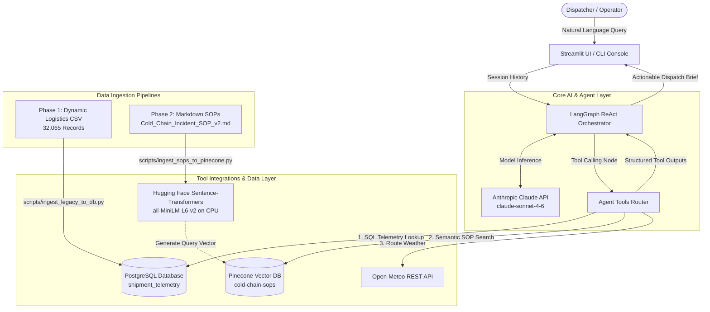
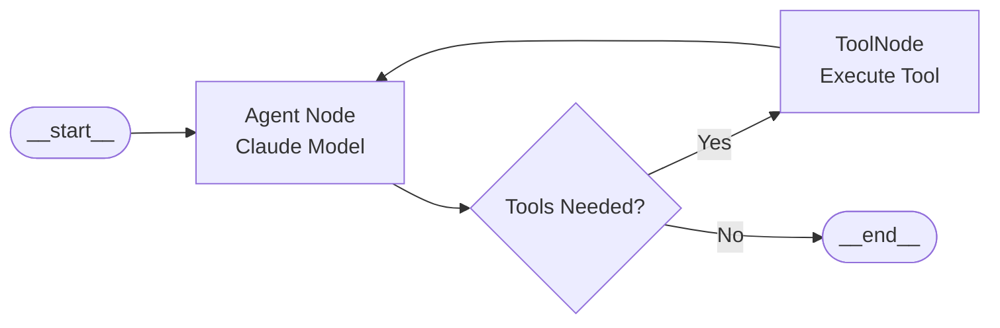

# AI-Powered Cold Chain Logistics Operations Assistant

An enterprise-grade, agentic operations platform built from the perspective of a **Forward Deployed Engineer (FDE)**. The system enables logistics coordinators and dispatchers to query live fleet telemetry, evaluate cold-chain compliance breaches, cross-reference Standard Operating Procedures (SOPs), and assess route weather risks using an autonomous LangGraph agent powered by Anthropic Claude.

---

## 1. Project Overview

Cold-chain logistics operations require continuous vigilance over temperature-sensitive cargo (such as vaccines, biologics, dairy, and perishables). Even a brief temperature deviation or an unforeseen transit bottleneck can spoil millions of dollars worth of inventory and cause regulatory violations.

This project delivers an autonomous, end-to-end AI assistant and operational monitoring platform. Instead of forcing dispatchers to cross-reference multiple disjoint dashboards, tabular databases, weather reports, and PDF compliance binders, this platform integrates:
- Relational telemetry records stored in **PostgreSQL**.
- Standard Operating Procedure (SOP) rulebooks indexed via **Pinecone Vector Search**.
- Live route and ambient transit weather fetched via **Open-Meteo**.
- Multi-step reasoning and tool execution orchestrated by **LangGraph** with **Anthropic Claude**.
- Dual frontends: An interactive **Streamlit Web Console** and a lightweight **Terminal CLI**.

---

## 2. Business Problem and Motivation

Logistics operations teams face operational friction across several operational vectors:
1. **Disparate Data Silos:** Telemetry logs reside in SQL databases, compliance rules reside in markdown/PDF SOP binders, and weather forecasts reside in external services.
2. **Delayed Excursion Response:** When a refrigerated container (reefer) fails, operators must quickly identify the incident, verify allowed temperature bounds, determine driver actions, and locate diversion facilities.
3. **Complex Multi-Condition SOPs:** Rules such as *"Divert to Inland Empire Overflow Depot if port congestion exceeds 7.0"* or *"Escalate to Tier 2 Manager only if risk is classified as High Risk AND delay probability exceeds 65%"* require strict adherence without human oversight errors.
4. **Budget & Infrastructure Constraints:** Production-grade architectures often incur heavy cloud infrastructure costs. This solution prioritizes a zero-cost local footprint: running embeddings locally on CPU and using free-tier serverless services.

---

## 3. Project Objectives

- **Natural Language Dispatch Assistant:** Allow operators to query fleet telemetry, incident histories, and SOP rules using natural language.
- **Automated Root-Cause Correlation:** Compare in-cargo IoT temperature against external ambient weather to determine whether deviations are caused by external heatwaves or mechanical reefer unit failures.
- **Strict Policy Grounding:** Enforce company-specific SOP thresholds without model hallucinations.
- **High Performance & Modular Design:** Decouple data access, embedding generation, tool invocation, and UI layers using a production-grade `src/` layout.

---

## 4. Proposed System Architecture

The following diagram illustrates the decoupled architecture of the platform:



---

## 5. Technology Stack and Purpose

| Component | Technology | Role & Purpose | Cost Profile |
|---|---|---|---|
| **Language & Runtime** | Python 3.12 | Core programming environment | Free / Open-Source |
| **Agent Orchestration** | LangGraph (`>=1.2.17`) | Stateful cyclic graph workflow, conditional routing, tool binding | Open-Source |
| **LLM Reasoning** | Anthropic Claude (`claude-sonnet-4-6`) | Intent recognition, multi-step tool call decisions, policy synthesis | Pay-per-token API |
| **Relational Database** | PostgreSQL 18 + SQLAlchemy + psycopg3 | Persistent storage for 32,065 structured logistics and sensor logs | Local / Zero-Cost |
| **Vector Database** | Pinecone Serverless | Vector storage and cosine similarity search for operational SOPs | Free Tier Index |
| **Dense Embeddings** | Hugging Face Sentence-Transformers (`all-MiniLM-L6-v2`) | Converts SOP sections into 384-dimensional dense vectors on CPU | 100% Free / Local |
| **Route Weather Service** | Open-Meteo REST API | Real-time ambient temperature, humidity, and weather codes by GPS | Free (No Key Required) |
| **Web Dashboard** | Streamlit (`1.37.1`) | Operations console, KPI metric cards, and telemetry browser | Open-Source |
| **Terminal Interface** | Python CLI (`cli.py`) | Interactive terminal console bypassing web rendering overhead | Open-Source |

---

## 6. End-to-End Workflow of a User Question

When a dispatcher submits a question (e.g., *"Check telemetry for Record ID 3727 and advise on SOP compliance"*):

```
1. Input Capture:
   User submits prompt via Streamlit chat input or CLI prompt.

2. State Initialization:
   The query is wrapped in a HumanMessage and passed into the LangGraph state graph.

3. Agent Reasoning Node:
   Anthropic Claude receives the prompt along with the tool schema definitions and system guardrails.
   Claude identifies the need to inspect telemetry for Record ID 3727.

4. Tool Call Execution:
   The tool node invokes `lookup_telemetry_record(3727)`.
   SQLAlchemy queries `cold_chain_db` and returns:
   - Cargo Temp: 39.99°C (Allowed: 0.0°C to 4.0°C)
   - Port Congestion Level: 9.93 (Threshold: > 7.0)
   - ETA Delay: +3.83 hours
   - Location: 36.017°N, -118.952°W

5. Autonomous Follow-up Actions:
   Claude evaluates the output and triggers secondary tools:
   - `fetch_ambient_weather(36.017, -118.952)` -> Ambient temp is 11.9°C (mild weather).
   - `search_cold_chain_sops("temperature excursion above 4.0 and port congestion")` -> Pinecone returns SOP v2.4 Sections 1 & 2.

6. Policy Synthesis & Output:
   Claude cross-references telemetry, ambient weather, and SOP rules:
   - Identifies internal cooling failure (cargo is 39.99°C while ambient is 11.9°C).
   - Declares Critical Breach under SOP Section 1.
   - Instructs diversion to Inland Empire Overflow Depot (San Bernardino) under SOP Section 2.
   - Delivers concise, actionable dispatch brief to user.
```

---

## 7. Database Design and Logistics Data

The database layer utilizes **SQLAlchemy ORM** backed by **PostgreSQL 18** with connection pooling (`pool_size=10`, `pool_pre_ping=True`).

### Table Schema: `shipment_telemetry`
Defined in `src/db/models.py`, capturing all 26 operational features from the dataset:

| Column Name | Type | Description |
|---|---|---|
| `id` | `INTEGER` | Primary Key (Auto-incrementing) |
| `timestamp` | `TIMESTAMP` | Timestamp of telemetry transmission (Indexed) |
| `vehicle_gps_latitude` | `FLOAT` | GPS Latitude coordinates |
| `vehicle_gps_longitude` | `FLOAT` | GPS Longitude coordinates |
| `iot_temperature` | `FLOAT` | In-cargo reefer sensor temperature in °C (Indexed) |
| `port_congestion_level` | `FLOAT` | Severity index from 0.0 to 10.0 (Indexed) |
| `traffic_congestion_level` | `FLOAT` | Regional highway traffic congestion index |
| `eta_variation_hours` | `FLOAT` | Variance against scheduled arrival time |
| `delay_probability` | `FLOAT` | Model-estimated delay likelihood (0.0 to 1.0) |
| `risk_classification` | `VARCHAR(50)` | Risk category (`Low Risk`, `Moderate Risk`, `High Risk`) |
| `weather_condition_severity` | `FLOAT` | Historical transit corridor severity index |
| `fuel_consumption_rate` | `FLOAT` | Engine fuel usage metric |
| `driver_behavior_score` | `FLOAT` | Telematics driving safety score |
| `fatigue_monitoring_score` | `FLOAT` | In-cab sensor fatigue metric |
| *(Additional columns)* | `FLOAT` | Inventory levels, equipment availability, costs, lead time |

### Business Logic Properties on ORM Model
- `is_temperature_breach`: Returns `True` if `iot_temperature > 4.0°C`.
- `is_port_congested`: Returns `True` if `port_congestion_level > 7.0`.
- `requires_tier2_escalation`: Returns `True` if `risk_classification == 'High Risk'` AND `delay_probability > 0.65`.

---

## 8. SOP Ingestion and RAG Pipeline

Standard Operating Procedures are ingested into **Pinecone** via a dedicated ETL script (`scripts/ingest_sops_to_pinecone.py`):

1. **Source Document:** `data/sops/Cold_Chain_Incident_SOP_v2.md` (Southern California Logistics Operations SOP v2.4).
2. **Chunking Strategy:** Documents are parsed by markdown section headers (`### `) into discrete semantic policy chunks:
   - *Section 1:* Temperature Control & Spoilage Prevention (0.0°C–4.0°C threshold, reefer restart, cold-storage diversion).
   - *Section 2:* Route Congestion & Diversion Tactics (Port of Long Beach/LA > 7.0 diversion to San Bernardino).
   - *Section 3:* Risk Classification Triggers (High Risk + delay probability > 0.65).
3. **Local Embedding Generation:** Each chunk is converted into a 384-dimensional dense vector using `sentence-transformers/all-MiniLM-L6-v2`. Embeddings run locally on CPU, ensuring zero external embedding API costs.
4. **Vector Upsert:** Vectors and metadata (`text`, `source`, `chunk_id`) are indexed in the `cold-chain-sops` serverless index on Pinecone.
5. **Retrieval (`src/rag/vector_store.py`):** Configured to retrieve with `top_k=1` to inject only the exact triggering SOP into the model's context window.

---

## 9. LangGraph Agent and Tool Descriptions

The orchestration engine is assembled in `src/agent/graph.py` using a LangGraph `StateGraph`.



### Registered Agent Tools (`src/agent/tools.py`)
1. **`lookup_telemetry_record(record_id: int)`**  
   Queries PostgreSQL via `LogisticsRepository` for a specific vehicle record and returns temperature, port congestion, delay probability, risk category, and GPS coordinates.
2. **`query_fleet_breaches_and_alerts(alert_type: str, limit: int)`**  
   Scans the database for active anomalies across categories: `'temperature'` (>4.0°C), `'congestion'` (>7.0), or `'escalations'` (High Risk + Delay > 0.65).
3. **`search_cold_chain_sops(query: str)`**  
   Performs semantic vector search against Pinecone to locate operational mitigation guidelines.
4. **`fetch_ambient_weather(latitude: float, longitude: float)`**  
   Fetches live outdoor ambient weather for the transit GPS coordinates.

---

## 10. Weather Integration

Integrated via `src/services/weather_service.py` using the **Open-Meteo REST API**:
- **Endpoint:** `https://api.open-meteo.com/v1/forecast`
- **Parameters:** `latitude`, `longitude`, `temperature_2m`, `relative_humidity_2m`, `wind_speed_10m`, `weather_code`.
- **Operational Value:** Differentiates between:
  - *Internal Equipment Failure:* In-cargo temp is 40°C while ambient temperature is 12°C.
  - *External Thermal Load:* In-cargo temp rises during a 42°C regional heatwave.

---

## 11. Security, Read-Only SQL Access, and Audit Logging

- **Credential Isolation:** Secrets (`DATABASE_URL`, `ANTHROPIC_API_KEY`, `PINECONE_API_KEY`) are managed exclusively through `.env` and loaded via `pydantic-settings`. `.env` is explicitly ignored in `.gitignore`.
- **Safe Database Access:** The repository layer (`src/db/repository.py`) uses parameterized SQLAlchemy ORM queries, eliminating SQL injection risks.
- **Read-Only Agent Surface:** The agent's database tool does not accept raw, unvalidated SQL strings from the model. It routes through predefined repository queries (`get_telemetry_by_id`, `get_active_excursions`).
- **Audit Traceability:** In the PostgreSQL schema, all telemetry events maintain timestamps and indexed primary keys for incident recreation.

---

## 12. Project Directory Structure

```text
Cold_chain_logistics(FDE)/
├── .env.example                          # Environment variable configuration template
├── .gitignore                            # Git exclusion rules (.env, __pycache__, etc.)
├── requirements.txt                      # Project dependency specification
├── README.md                             # System documentation
├── app.py                                # Root entrypoint for Streamlit web UI
├── cli.py                                # Interactive terminal CLI entrypoint
│
├── data/
│   ├── legacy/
│   │   └── dynamic_supply_chain_logistics_dataset.csv  # 32,065 historical logistics rows
│   └── sops/
│       ├── Cold_Chain_Incident_SOP_v2.md               # Active Southern California SOP v2.4
│       ├── incident_escalation.md                      # Escalation severity guidelines
│       └── temperature_guidelines.md                   # Cargo category temperature ranges
│
├── scripts/
│   ├── ingest_legacy_to_db.py            # Streamlined batch loader: CSV -> PostgreSQL
│   └── ingest_sops_to_pinecone.py        # Chunking & local embedding -> Pinecone
│
├── src/
│   ├── __init__.py
│   ├── config/
│   │   ├── __init__.py
│   │   └── settings.py                   # Pydantic BaseSettings configuration
│   ├── db/
│   │   ├── __init__.py
│   │   ├── connection.py                 # SQLAlchemy engine and session factory
│   │   ├── models.py                     # 26-column ShipmentTelemetry ORM model
│   │   └── repository.py                 # Data access layer and query filters
│   ├── rag/
│   │   ├── __init__.py
│   │   ├── embeddings.py                 # Local Sentence-Transformers embedding utility
│   │   └── vector_store.py               # Pinecone index client and retrieval wrapper
│   ├── services/
│   │   ├── __init__.py
│   │   └── weather_service.py            # Open-Meteo REST API wrapper
│   ├── agent/
│   │   ├── __init__.py
│   │   ├── state.py                      # LangGraph AgentState TypedDict definition
│   │   ├── prompts.py                    # System prompts, guardrails, and brevity constraints
│   │   ├── tools.py                      # Agent tools (PostgreSQL, Pinecone, Open-Meteo)
│   │   └── graph.py                      # Compiled ReAct workflow with Claude
│   └── ui/
│       ├── __init__.py
│       └── app.py                        # Streamlit operations dashboard implementation
│
└── tests/
    ├── __init__.py
    └── test_services.py                  # Integration test for Open-Meteo service
```

---

## 13. Installation and Local Setup

### Prerequisites
- Python 3.12+
- PostgreSQL 14+ installed and running locally
- Pinecone account (Free tier)
- Anthropic API key

### Setup Steps

1. **Clone the repository:**
   ```bash
   git clone <your-repo-url>
   cd Cold_chain_logistics(FDE)
   ```

2. **Create and activate a virtual environment:**
   ```bash
   python -m venv .venv
   # Windows PowerShell:
   .venv\Scripts\Activate.ps1
   # Linux/macOS:
   source .venv/bin/activate
   ```

3. **Install dependencies:**
   ```bash
   pip install -r requirements.txt
   ```

4. **Configure environment variables:**
   Copy `.env.example` to `.env`:
   ```bash
   cp .env.example .env
   ```

---

## 14. Environment Variables

Populate `.env` with your credentials:

```ini
# PostgreSQL Database Connection
# Note: Encode special characters in passwords (e.g., '@' becomes '%40')
DATABASE_URL=postgresql+psycopg://<username>:<password>@localhost:5432/<database_name>

# Anthropic Claude API Key
ANTHROPIC_API_KEY=sk-ant-api03-...
ANTHROPIC_MODEL=claude-sonnet-4-6

# Pinecone Vector Database
PINECONE_API_KEY=pcsk_...
PINECONE_INDEX_NAME=cold-chain-sops

# Open-Meteo Base URL (Free REST service, no API key required)
OPEN_METEO_BASE_URL=https://api.open-meteo.com/v1/forecast
```

---

## 15. How to Run the Application

### Step 1: Run Data Ingestion Pipelines (One-Time Execution)

Initialize PostgreSQL tables and ingest historical telemetry:
```bash
python scripts/ingest_legacy_to_db.py
```
*Loads 32,065 rows into `shipment_telemetry`.*

Index domain SOP documents into Pinecone:
```bash
python scripts/ingest_sops_to_pinecone.py
```
*Creates the serverless index, generates embeddings, and upserts semantic chunks.*

### Step 2: Run the Terminal CLI (Recommended for Fast Testing)
```bash
python cli.py
```
*Launches an interactive prompt directly in your console with zero web rendering lag.*

### Step 3: Run the Streamlit Operations Console
```bash
python -m streamlit run app.py
```
*Opens the web dashboard in your browser at `http://localhost:8501`.*

---

## 16. Example Questions Users Can Ask

The assistant handles operational queries across multiple analytical categories:

### 1. Specific Record Investigation
- *"Check telemetry for Record ID 3727. What is the current cargo temperature, and what immediate actions does SOP v2.4 require?"*
- *"Investigate Record ID 19400. Are there any port congestion issues along this route, and where should we divert the freight?"*

### 2. Multi-Condition Escalation Evaluation
- *"Does Record ID 15723 require escalation to the Tier 2 Logistics Manager? Check both risk classification and delay probability."*
- *"Evaluate Record ID 1. Does the delay probability justify an escalation under our SOP?"*

### 3. Fleet-Wide Anomaly Audits
- *"Scan the fleet for active temperature breaches and list the top 3 critical shipments."*
- *"Are there any vehicles currently experiencing port congestion above index 7.0?"*

### 4. Direct SOP Knowledge Retrieval
- *"What are the acceptable temperature thresholds for fresh perishables in SOP v2.4?"*
- *"What is our exact protocol when port congestion exceeds 7.0 at the Port of Long Beach?"*

---

## 17. Testing and Validation

The implementation has been verified through targeted tests:
- **Database Ingestion Validation:** Confirmed via `LogisticsRepository.get_summary_metrics()`:
  - Total records: `32,065`
  - Active temperature breaches (>4.0°C): `8,674`
  - Port congestion alerts (>7.0): `19,566`
  - Tier 2 escalations: `15,440`
- **Vector Retrieval Validation:** Tested in `src/rag/vector_store.py` with semantic queries, returning relevant chunks from `Cold_Chain_Incident_SOP_v2.md`.
- **Weather API Sanity Check:** Verified in `tests/test_services.py` across sample GPS coordinates.
- **End-to-End Agent Execution:** Verified in CLI tests executing complete multi-tool reasoning sequences.

---

## 18. Current Implementation Status and Remaining Tasks

### ✅ Completed & Implemented
- [x] Production modular `src/` directory layout.
- [x] PostgreSQL database integration with SQLAlchemy ORM and connection pooling.
- [x] Phase 1 batch ingestion streaming 32,065 records into `cold_chain_db`.
- [x] Phase 2 SOP ingestion pipeline using local Hugging Face embeddings and Pinecone.
- [x] Open-Meteo REST API client for coordinate-based weather lookups.
- [x] LangGraph ReAct agent orchestration with tool nodes and conditional edges.
- [x] Grounded FDE system prompts with strict brevity guardrails.
- [x] Interactive Terminal CLI (`cli.py`).
- [x] Streamlit operations dashboard with caching (`app.py`).

### ⏳ Planned Enhancements (Remaining Roadmap)
- [ ] **Streaming Agent Responses in Streamlit:** Upgrade UI from batch message delivery to token-by-token streaming using LangGraph's `.stream()` API.
- [ ] **Automated Alert Webhooks:** Connect agent escalation decisions to email/Slack notifications (e.g., via SendGrid or Slack webhooks) when Tier 2 escalations trigger.
- [ ] **Map Visualization:** Integrate Streamlit PyDeck or Folium maps to display real-time truck GPS pins color-coded by temperature breach severity.
- [ ] **Comprehensive Unit Test Suite:** Expand `tests/` with mocks for Claude and Pinecone calls.

---

## 19. Limitations and Future Improvements

- **Local Process Hosting:** Running the Streamlit server locally requires the host machine to remain active. A production deployment would benefit from containerization with Docker and hosting on an orchestration platform (e.g., AWS ECS or Kubernetes).
- **Static Ingest vs. Real-Time Streaming:** The current system ingests historical CSV logs in batches. A future improvement would attach an MQTT or Kafka message broker to ingest streaming IoT sensor packets in real time.
- **Single-Turn Model Context:** The agent currently maintains conversation history within session state; implementing LangGraph persistent checkpointers (e.g., `MemorySaver` or `PostgresSaver`) will enable persistent multi-session thread recovery.
- **Model Rate Limits:** The solution relies on external Anthropic API rate limits. Implementing client-side retry logic and fallback models will improve resilience under heavy concurrent load.

---

## 📜 License
This project is developed as an AI Forward Deployed Engineering (FDE) operational reference implementation under the MIT License.

---

## 16. Example Questions Users Can Ask

The assistant handles operational queries across multiple analytical categories:

### 1. Specific Record Investigation
- *"Check telemetry for Record ID 3727. What is the current cargo temperature, and what immediate actions does SOP v2.4 require?"*
- *"Investigate Record ID 19400. Are there any port congestion issues along this route, and where should we divert the freight?"*

### 2. Multi-Condition Escalation Evaluation
- *"Does Record ID 15723 require escalation to the Tier 2 Logistics Manager? Check both risk classification and delay probability."*
- *"Evaluate Record ID 1. Does the delay probability justify an escalation under our SOP?"*

### 3. Fleet-Wide Anomaly Audits
- *"Scan the fleet for active temperature breaches and list the top 3 critical shipments."*
- *"Are there any vehicles currently experiencing port congestion above index 7.0?"*

### 4. Direct SOP Knowledge Retrieval
- *"What are the acceptable temperature thresholds for fresh perishables in SOP v2.4?"*
- *"What is our exact protocol when port congestion exceeds 7.0 at the Port of Long Beach?"*

---

## 17. Testing and Validation

The implementation has been verified through targeted tests:
- **Database Ingestion Validation:** Confirmed via `LogisticsRepository.get_summary_metrics()`:
  - Total records: `32,065`
  - Active temperature breaches (>4.0°C): `8,674`
  - Port congestion alerts (>7.0): `19,566`
  - Tier 2 escalations: `15,440`
- **Vector Retrieval Validation:** Tested in `src/rag/vector_store.py` with semantic queries, returning relevant chunks from `Cold_Chain_Incident_SOP_v2.md`.
- **Weather API Sanity Check:** Verified in `tests/test_services.py` across sample GPS coordinates.
- **End-to-End Agent Execution:** Verified in CLI tests executing complete multi-tool reasoning sequences.

---

## 18. Current Implementation Status and Remaining Tasks

### ✅ Completed & Implemented
- [x] Production modular `src/` directory layout.
- [x] PostgreSQL database integration with SQLAlchemy ORM and connection pooling.
- [x] Phase 1 batch ingestion streaming 32,065 records into `cold_chain_db`.
- [x] Phase 2 SOP ingestion pipeline using local Hugging Face embeddings and Pinecone.
- [x] Open-Meteo REST API client for coordinate-based weather lookups.
- [x] LangGraph ReAct agent orchestration with tool nodes and conditional edges.
- [x] Grounded FDE system prompts with strict brevity guardrails.
- [x] Interactive Terminal CLI (`cli.py`).
- [x] Streamlit operations dashboard with caching (`app.py`).

### ⏳ Planned Enhancements (Remaining Roadmap)
- [ ] **Streaming Agent Responses in Streamlit:** Upgrade UI from batch message delivery to token-by-token streaming using LangGraph's `.stream()` API.
- [ ] **Automated Alert Webhooks:** Connect agent escalation decisions to email/Slack notifications (e.g., via SendGrid or Slack webhooks) when Tier 2 escalations trigger.
- [ ] **Map Visualization:** Integrate Streamlit PyDeck or Folium maps to display real-time truck GPS pins color-coded by temperature breach severity.
- [ ] **Comprehensive Unit Test Suite:** Expand `tests/` with mocks for Claude and Pinecone calls.

---

## 19. Limitations and Future Improvements

- **Local Process Hosting:** Running the Streamlit server locally requires the host machine to remain active. A production deployment would benefit from containerization with Docker and hosting on an orchestration platform (e.g., AWS ECS or Kubernetes).
- **Static Ingest vs. Real-Time Streaming:** The current system ingests historical CSV logs in batches. A future improvement would attach an MQTT or Kafka message broker to ingest streaming IoT sensor packets in real time.
- **Single-Turn Model Context:** The agent currently maintains conversation history within session state; implementing LangGraph persistent checkpointers (e.g., `MemorySaver` or `PostgresSaver`) will enable persistent multi-session thread recovery.
- **Model Rate Limits:** The solution relies on external Anthropic API rate limits. Implementing client-side retry logic and fallback models will improve resilience under heavy concurrent load.

---

## 📜 License
This project is developed as an AI Forward Deployed Engineering (FDE) operational reference implementation under the MIT License.

